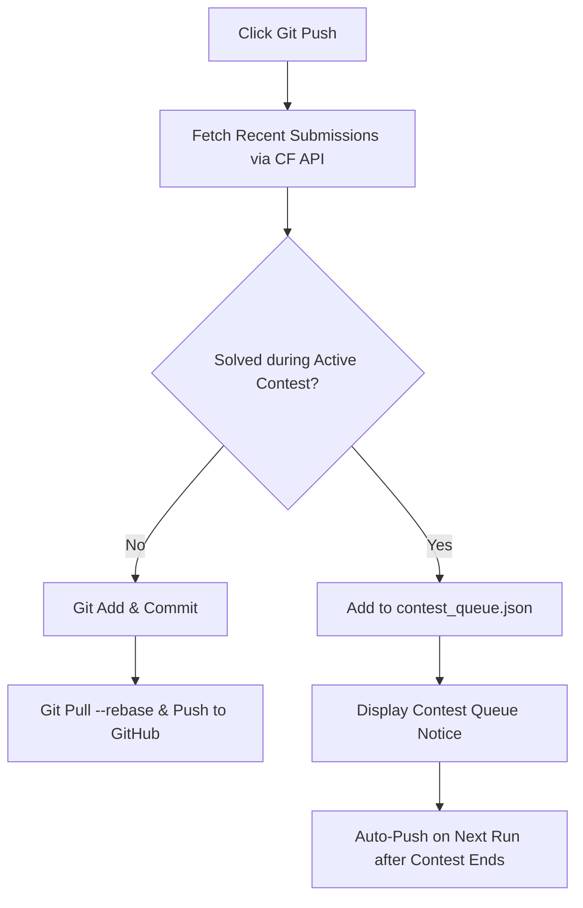

# CFMT — Codeforces Management Tool

<div align="center">


<p align="center">
  <b>A comprehensive tool designed to streamline your Codeforces competitive programming workflow.</b><br>
  Automate boilerplate generation, multi-problem tab management, compilation, test input execution, and GitHub solution archiving with built-in contest anti-cheating protection.
</p>

[Download GUI Executable](https://github.com/mi-shraban/CFMT/releases/tag/v_1.1) • [Report Bug](https://github.com/mi-shraban/CFMT/issues) • [Request Feature](https://github.com/mi-shraban/CFMT/issues)

</div>

---

## Preview

<div align="center">
  
</div>

---

## Features

- **Automated Solution Setup**: Generates problem files (`<ProblemID>.cpp` or `<ProblemID>.py`) pre-filled with your custom templates.
- **Multi-File Tab System**: Solve and manage multiple contest problems in parallel with independent test inputs and outputs.
- **Integrated Compile & Run**:
  - One-click compile for C++ using `g++ -std=c++14`.
  - Direct execution for Python and C++ with custom test case input boxes.
- **Contest Anti-Cheating & Queue Protection**:
  - Automatically queries the Codeforces API (`user.status` & `contest.list`) to check if a problem was solved during an active, ongoing contest.
  - Automatically defers Git pushes to `contest_queue.json` until the official contest finishes to ensure compliance with Codeforces rules against sharing code during rounds.
  - Automatically pushes all queued solutions to GitHub once the contest ends.
- **Seamless Git & GitHub Integration**:
  - Automatically clones or connects to your personal GitHub solutions repository.
  - Formats commit messages (`solved <ProblemID>`).
  - Automatically pulls latest updates (`git pull --rebase --autostash`) and pushes directly to `main`.
- **Modern Themes**: Built with `ttkbootstrap`, featuring over 10 themes (*Darkly*, *Cyborg*, *Vapor*, *Solar*, *Superhero*, *Flatly*, *Litera*, etc.) with persistent theme preferences.
- **Dual Interfaces**: Choose between the feature-rich **GUI** (`cfmt_gui.py` / `cfmt_gui.exe`) and the fast **CLI** (`cfmt.py`).

---

## Requirements & Prerequisites

### Prerequisites
1. **Python 3.8+** installed on your system.
2. **Git**: Installed and configured on your machine:
   ```bash
   git config --global user.name "Your GitHub Username"
   git config --global user.email "your_email@example.com"
   ```
   *(Alternatively, log in via [GitHub Desktop](https://desktop.github.com/)).*
3. **C++ Compiler (Optional, for C++)**: `g++` (MinGW / GCC) available in your system `PATH`.
4. **VS Code (Optional, for CLI)**: Make sure the `code` command is accessible from your terminal if using the CLI auto-open feature.

### Python Dependencies
Install the required packages using `requirements.txt`:
```bash
pip install -r requirements.txt
```

Core dependencies:
- [`requests`](https://pypi.org/project/requests/): Handles Codeforces REST API requests for profile validation and contest status.
- [`ttkbootstrap`](https://pypi.org/project/ttkbootstrap/): Provides modern flat styling and dark mode themes for the Tkinter GUI.
- [`PySide6`](https://pypi.org/project/PySide6/) *(Optional)*: Required only if running the alternative Qt-based GUI (`cfmt_gui_pyside6.py`).

---

## Getting Started

### Option 1: Standalone Windows Executable (No Python Required)
1. Download `cfmt_gui.exe` from the [Latest Releases](https://github.com/mi-shraban/CFMT/releases/tag/v_1.1).
2. Place `cfmt_gui.exe` into a folder along with `cpp_template.txt` and `py_template.txt`.
3. Double-click `cfmt_gui.exe` to launch.

### Option 2: Running from Source

#### 1. Clone the Repository
```bash
git clone https://github.com/mi-shraban/CFMT.git
cd CFMT
```

#### 2. Set Up a Virtual Environment (Recommended)
```bash
# Windows (Command Prompt / PowerShell)
python -m venv venv
venv\Scripts\activate
```

#### 3. Install Dependencies
```bash
pip install -r requirements.txt
```

---

## Usage Guide

### 1. Launching the GUI
Run the primary GUI application:
```bash
python cfmt_gui.py
```

- **First-Time Setup**: Enter your GitHub username, the name of your solutions repository, and your Codeforces handle. The tool validates your Codeforces handle via the API and clones the repository if it isn't already present locally.
- **Creating a Problem**:
  1. Enter the Problem ID (e.g., `2160B`, `1915C`).
  2. Select your language (`Python` or `C++`).
  3. Click **Create Code File**. A new tab will appear in the bottom tab bar.
- **Writing & Testing Code**:
  1. Edit the generated file in your preferred editor.
  2. Paste test inputs into the **Input Box**.
  3. Click **Compile (C++)** (for C++ files) and **Run Code** to execute against the input. Output will be displayed in the **Logs & Outputs** panel.
- **Submitting to GitHub**:
  - Once your solution is accepted on Codeforces, click **Git Push**.
  - If the contest is over, it immediately pushes to GitHub.
  - If the contest is still active, CFMT places it in the contest queue and will auto-push after the contest finishes.

---

### 2. Launching the CLI
Run the terminal-based interactive tool:
```bash
python cfmt.py
```

- Enter the Problem ID when prompted (e.g., `2160B`).
- Enter the language extension (`cpp` or `py`).
- The problem file is populated with your template and automatically opened in VS Code.
- Interactive terminal options:
  - `c` — Compile C++ solution (`g++ -std=c++14`)
  - `r` — Run compiled binary or Python script
  - `g` — Commit and push to GitHub (with anti-cheating check)
  - `q` — Quit

---

### 3. Alternative Qt GUI (PySide6)
If you prefer a Qt interface:
```bash
python cfmt_gui_pyside6.py
```

---

## Configuration & Templates

### User Configuration
Your settings are stored locally in `user_config.json`:
```json
{
    "github_username": "your-github-username",
    "git_repo_name": "your-cf-solutions-repo",
    "cf_username": "your-codeforces-handle"
}
```
*To reconfigure your accounts, simply delete or edit `user_config.json`.*

### Customizing Code Templates
Customize your initial solution templates by editing:
- `cpp_template.txt`: Default C++ boilerplate (includes Fast I/O, common type definitions, and `solve()` structure).
- `py_template.txt`: Default Python boilerplate.

---

## Contest Queue & Anti-Cheating Logic

Codeforces strictly prohibits public sharing of contest solutions while a contest is running. CFMT protects you automatically:



1. Queries `https://codeforces.com/api/user.status` and `https://codeforces.com/api/contest.list`.
2. If an `OK` or `PARTIAL` verdict is detected from participant type `CONTESTANT` during an ongoing contest, the push is delayed.
3. The file is saved in `contest_queue.json` with the contest end timestamp.
4. On subsequent app launches, any queued solutions whose contests have concluded are automatically pushed to GitHub.

---

## Project Structure

```text
CFMT/
│
├── cfmt.py                  # Command-line interface (CLI) tool
├── cfmt_gui.py              # Primary GUI application (ttkbootstrap)
├── cfmt_gui.exe             # Pre-built Windows binary of the GUI
├── cfmt_gui_pyside6.py      # Alternative GUI implementation (PySide6)
│
├── cpp_template.txt         # C++ solution boilerplate template
├── py_template.txt          # Python solution boilerplate template
│
├── requirements.txt         # Python package dependencies
├── README.md                # Project documentation
│
├── codeforces.ico           # Application window icon
├── cfmt.png                 # Application preview banner
│
├── user_config.json         # (Generated) User GitHub & CF configuration
└── contest_queue.json       # (Generated) Contest-delayed solutions queue
```

---

## Contributing

Contributions, bug reports, and feature requests are welcome!

1. Fork the Project
2. Create your Feature Branch (`git checkout -b feature/AmazingFeature`)
3. Commit your Changes (`git commit -m "Add some AmazingFeature"`)
4. Push to the Branch (`git push origin feature/AmazingFeature`)
5. Open a Pull Request

---

## License

This project is open-source and available under the [MIT License](LICENSE).
